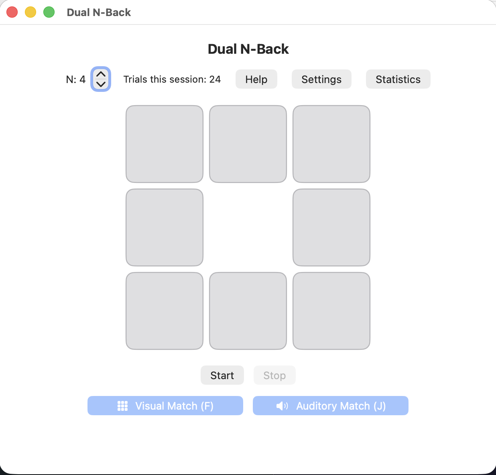
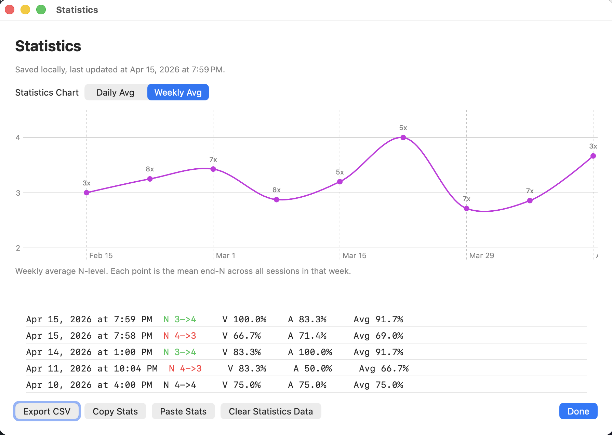
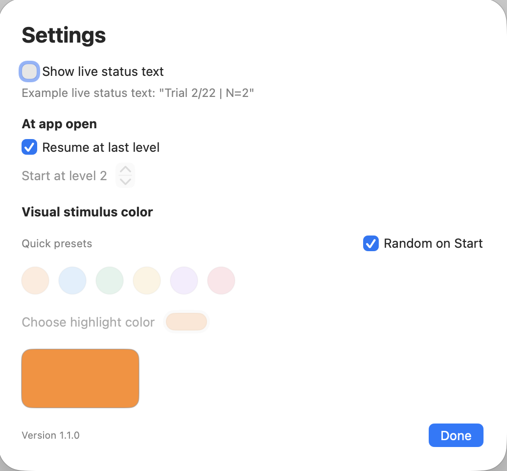

# Dual N-Back

A native iPhone dual n-back cognitive training app.

The macOS app is retired as of October 26, 2026. Future development focuses on iPhone. Existing Mac downloads and source remain available, but no further Mac releases or Homebrew updates are planned.

## 🧠 Features

- 3×3 grid with a visual (position) stimulus and a spoken letter audio stimulus each trial.
- Press `F` for a visual match, `J` for an auditory match — or use the on-screen buttons.
- Adaptive difficulty: N moves up after sessions ≥90% accurate, down below 75%.
- 3-2-1 countdown before each session and match buttons locked during warmup trials.
- Choose from three natural spoken voices. The recordings ship with the app, so they work offline and no account is needed.
- Highlight color picker with quick presets and a **Random on Start** option.
- Statistics window with session history, daily and weekly average N-level charts, and CSV export.
- Cross-device stats sync via Universal Clipboard (copy on Mac, paste on iPhone, or vice versa).
- Local-first: all data stored in `~/Library/Application Support/DualNBack/score_history.json`.
- No browser, no Electron, no external dependencies — pure SwiftUI.

## 📸 Screenshots

| Main | Statistics | Settings |
|------|------------|----------|
|  |  |  |

## 📱 iPhone app & cross-device sync

The iOS version is the same training experience on your iPhone — same grid, same adaptive difficulty, same session history. All data stays local on each device (no account, no cloud).

**Cross-device sync** lets you merge your session history between Mac and iPhone using Universal Clipboard:

1. On one device, open **Statistics → Copy Stats to Clipboard**.
2. On the other device, open **Statistics → Paste Stats from Clipboard**.

The paste merges the incoming sessions with your local history, deduplicating any overlap. It works in both directions. Universal Clipboard requires both devices to be signed into the same Apple ID and within Bluetooth/Wi-Fi range.

## 🎮 How to play

Each trial highlights one grid square and plays a spoken letter. You compare the current trial to the one `N` steps back.

- `F` — visual match (same position as N trials ago)
- `J` — auditory match (same letter as N trials ago)
- Both keys — if both match
- Neither — no response needed for non-matches

The app tracks hits, misses, and false positives per stream and adjusts N after each session.

## 📲 Install

### macOS — archived downloads

The final Mac release is [1.2.0](https://github.com/eweinhoffer/dual-n-back/releases/tag/v1.2.0). Its unsigned ZIPs and checksums remain available for Apple Silicon and Intel Macs. These downloads are unsupported; the Homebrew cask is deprecated and release/install-test automation has been removed.

### iPhone — free Apple ID, no App Store needed

The project is not on the App Store. You can still install it yourself for free with Xcode and a normal Apple ID; a paid Apple Developer membership is optional.

1. Install free [Xcode](https://apps.apple.com/app/xcode/id497799835) on a Mac, then sign in under **Xcode → Settings → Accounts**.
2. Download this repository, then open `DualNBackiOS/DualNBackiOS.xcodeproj`.
3. Connect your iPhone with a cable, select it from Xcode’s device menu, then choose your **Personal Team** in **Signing & Capabilities**.
4. If Xcode says the bundle identifier is unavailable, change it to something unique to you, such as `com.yourname.dualnback`.
5. Press **Run** (`Cmd+R`). If the iPhone asks, enable **Developer Mode** in **Settings → Privacy & Security**, restart it, then run again.

Free installs expire after 7 days, so reconnect and press **Run** again to renew them; installing over the existing app keeps its local statistics. Free Apple IDs also have a small limit on simultaneously installed development apps. A paid Apple Developer membership removes the 7-day renewal and enables TestFlight, but is not required to use this app yourself.

GitHub Release downloads are currently for macOS only. There is no downloadable iPhone IPA; iPhone installs are built from this source project and signed with your own Apple ID.

## ⚠️ macOS Gatekeeper

This app is unsigned and not notarized. macOS Gatekeeper may block the first launch.

If that happens:
- Right-click `Dual N-Back.app`, choose **Open**, then confirm.
- Or go to **System Settings → Privacy & Security → Open Anyway**.

Use official GitHub Release assets only — verify checksums before running.

## 🛠️ Source projects

### Requirements

- macOS 13 or newer
- Full Xcode 15+ in `/Applications/Xcode.app`

```bash
sudo xcode-select -s /Applications/Xcode.app/Contents/Developer
sudo xcodebuild -runFirstLaunch
sudo xcodebuild -license accept
```

### Build the retired Mac app from source

```bash
./BUILD_DOCK_APP.command
```

Output: `Dual N-Back.app` in the repo root.

### Open in Xcode

- **macOS + iOS together:** Open `DualNBack.xcworkspace` at the repo root.
- **macOS only:** Open `SwiftDualNBackPrototype/SwiftDualNBackPrototype.xcodeproj`.
- **iOS only:** Open `DualNBackiOS/DualNBackiOS.xcodeproj`.

### Preflight check

```bash
./scripts/check_build_env.sh
```

## 🔧 Troubleshooting

| Problem | Fix |
|---|---|
| `xcodebuild: command not found` | Install full Xcode, run `sudo xcode-select -s /Applications/Xcode.app/Contents/Developer` |
| Xcode points to CommandLineTools | Run `sudo xcode-select -s /Applications/Xcode.app/Contents/Developer` |
| First-launch or license errors | Run `sudo xcodebuild -runFirstLaunch` and `sudo xcodebuild -license accept` |
| Build script can't find app | Run `./scripts/check_build_env.sh`, then build again |

## 🔒 Security

- Release ZIPs include `SHA256SUMS.txt` for checksum verification.
- Optional release signatures via `SHA256SUMS.txt.sig` and `release-signing-public.pem`.
- Local security scan: `./scripts/security_scan.sh`

## 🧾 Changelog

- `1.2.0`: Adds three offline natural voice choices, faster statistics rendering, refreshed iPhone statistics, and installation guidance for free Apple IDs.
- `1.1.1`: Aligns Mac and iPhone version labels and improves stats sync/storage reliability.
- `1.1.0`: First public macOS release.

## ✍️ Author

Developed by [Eric Weinhoffer](https://www.ericweinhoffer.com)

[](https://www.buymeacoffee.com/eweinhoffer)

## 📄 License

MIT
